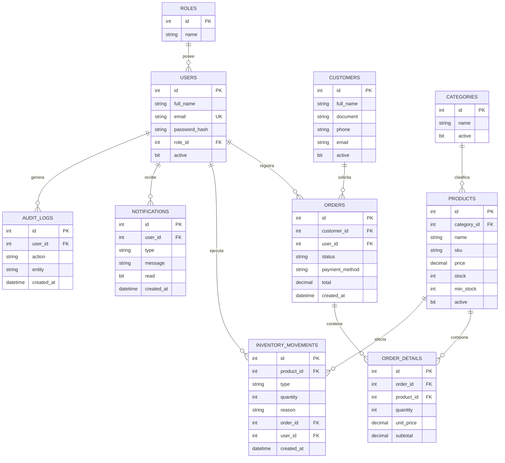

# ABASTIX — PLATAFORMA INTEGRAL DE GESTIÓN COMERCIAL, INVENTARIO Y POS

[](https://www.docker.com/)
[](https://react.dev/)
[](https://vitejs.dev/)
[](https://tailwindcss.com/)
[](https://spring.io/projects/spring-boot)
[](https://openjdk.org/)
[](https://www.microsoft.com/sql-server/)
[](https://www.rabbitmq.com/)
[](https://pnpm.io/)

---

## 1. PRESENTACIÓN DEL PROYECTO

### ¿Qué es Abastix?
**Abastix** es una plataforma web integral empresarial diseñada para modernizar y optimizar la gestión operativa, comercial y logística de comercios minoristas, bodegas y distribuidores mayoristas.

### ¿Qué problema resuelve?
Tradicionalmente, las pequeñas y medianas empresas comerciales gestionan su stock, ventas y créditos mediante registros manuales o libretas en papel. Esto genera:
- Descuadres recurrentes de existencias e inventario fantasma.
- Quiebres de stock no detectados a tiempo que provocan pérdida directa de ventas.
- Fraude por alteración de precios o cobros no registrados.
- Desconocimiento del flujo de caja, margen real y comportamiento de clientes.

Abastix centraliza el catálogo de productos, proporciona un terminal de punto de venta (POS) interactivo con cálculo automático de impuestos (IGV 18%), audita entradas y salidas mediante Kardex valorizado en tiempo real, procesa alertas automáticas de bajo stock mediante mensajería asíncrona (RabbitMQ) y brinda un panel de control con métricas e indicadores de rendimiento analíticos.

### Funcionalidades Principales
- **Landing Page Comercial:** Vitrina institucional con métricas de impacto, contraste de problema/solución, catálogo de módulos y llamada a la acción.
- **Autenticación Enterprise:** JWT stateless en cookies `HttpOnly; SameSite=Lax`, protección contra CSRF con token de doble submit y control de acceso basado en roles (`ROLE_ADMIN` y `ROLE_EMPLEADO`).
- **Terminal de Punto de Venta (POS):** Carrito de compras reactivo, selector de cantidades con validación de inventario en servidor, soporte de métodos de pago peruanos (Efectivo, Yape, Plin, Tarjeta, Transferencia) y actualización de estados (`CONFIRMADO`, `PREPARANDO`, `LISTO`, `ENTREGADO`, `CANCELADO`).
- **Catálogo y Categorías:** Búsqueda en vivo por nombre y código SKU/barras, filtrado por categorías, activación/desactivación y eliminación con confirmación.
- **Inventario y Kardex:** Auditoría física y contable con valuación de almacén en Soles (`S/`), registro clasificado de movimientos (`ENTRADA`, `SALIDA`, `AJUSTE`) y justificación obligatoria.
- **Mensajería Asíncrona (RabbitMQ):** Desacoplamiento de eventos de negocio (`ORDER_CONFIRMED`, `LOW_STOCK`) con persistencia en segundo plano en la bandeja de notificaciones.
- **Dashboard Analítico:** Métricas de facturación acumulada, pedidos procesados, alertas críticas y gráficos interactivos con ApexCharts.
- **Administración de Colaboradores:** Creación y control de acceso de usuarios exclusivo para administradores.

### Arquitectura Técnica
```
                   +-----------------------------------------------+
                   |        Navegador Web / Cliente Final          |
                   |      http://localhost:5173 (Docker Local)     |
                   |   https://abastix.vercel.app (Prod Frontend)  |
                   +-----------------------------------------------+
                                          |
                         [HTTP/REST con Cookies + CSRF]
                                          v
+-----------------------------------------------------------------------------------+
|                            ENTORNO DOCKER (Monorepo)                              |
|                                                                                   |
|  +---------------------------+             +----------------------------------+   |
|  |       frontend (5173)     |             |          backend (8088)          |   |
|  |  React 19 + Vite + Nginx  | --proxy-->  |  Spring Boot 4.1.1 (Java 21 JRE) |   |
|  |  SPA Fallback + Static    |   /api/*    |  Spring Security + JWT + JPA     |   |
|  +---------------------------+             +----------------------------------+   |
|                                                              |                    |
|                                         +--------------------+----------------+   |
|                                         |                                     |   |
|                                    [JDBC / TCP]                         [AMQP / TCP]  |
|                                         v                                     v   |
|                        +---------------------------------+  +-------------------+ |
|                        |        sqlserver (1433)         |  |  rabbitmq (5672)  | |
|                        |  Microsoft SQL Server 2022      |  |  AMQP + UI 15672  | |
|                        |  AbastixDB (10 Tablas + Seeds)  |  |  abastix.exchange | |
|                        +---------------------------------+  +-------------------+ |
|                                         ^                                         |
|                                         | ejecuta script al inicio                |
|                        +---------------------------------+                        |
|                        |      db-init (One-shot run)     |                        |
|                        |  sqlcmd idempotente: AbastixDB  |                        |
|                        +---------------------------------+                        |
+-----------------------------------------------------------------------------------+
```

---

## 2. REQUISITOS PREVIOS PARA EJECUTAR CON DOCKER

El modo de ejecución principal y recomendado es **Docker Compose**. Con este mecanismo **NO necesitas instalar** en tu máquina anfitriona Node.js, pnpm, Java JDK, Apache Maven, SQL Server ni RabbitMQ, ya que todos los servicios se ejecutan de manera aislada dentro de contenedores optimizados.

### Herramientas requeridas en la máquina anfitriona:
1. **Git:** Para clonar el repositorio.
2. **Docker Desktop** (en Windows o macOS) con el motor WSL2 activo, o **Docker Engine + Docker Compose v2+** (en Linux).
3. **Recursos de Hardware Recomendados:**
   - Mínimo 4 GB de memoria RAM libre (SQL Server 2022 requiere al menos 2 GB asignados a Docker).
   - 10 GB de espacio libre en disco para imágenes y volúmenes de datos.
4. **Puertos Locales Disponibles:**
   - `5173` (Frontend Web y Proxy Nginx)
   - `8088` (API Backend Spring Boot)
   - `1433` (Microsoft SQL Server)
   - `5672` (RabbitMQ Protocolo AMQP)
   - `15672` (RabbitMQ Panel de Administración Web)

### Comprobación de herramientas:
Ejecuta en tu terminal (PowerShell o Bash):
```bash
git --version
docker --version
docker compose version
```

Para verificar que el motor de Docker está encendido y accesible:
```bash
docker info
```

---

## 3. INSTALACIÓN DESDE CERO

Sigue estos pasos para poner en marcha el sistema completo en tu computadora:

### Paso 1: Clonar el repositorio y acceder a la carpeta
```bash
git clone https://github.com/tu-usuario/abastix.git
cd abastix
```

### Paso 2: Configurar las variables de entorno locales
Copia el archivo de plantilla `.env.example` para crear tu `.env` de trabajo:

**En Windows (PowerShell):**
```powershell
Copy-Item .env.example .env
```

**En Linux / macOS:**
```bash
cp .env.example .env
```

### Paso 3: Generar y configurar un secreto JWT seguro
Abre el archivo `.env` recién creado con tu editor de texto.

Genera una clave aleatoria de al menos 32 caracteres (256 bits):
- En Bash/Linux/macOS:
  ```bash
  openssl rand -base64 32
  ```
- En PowerShell:
  ```powershell
  [Convert]::ToBase64String((1..32 | ForEach-Object { Get-Random -Minimum 0 -Maximum 256 } | ForEach-Object { [byte]$_ }))
  ```

Pega la clave resultante en la variable `JWT_SECRET` dentro de tu `.env`:
```ini
JWT_SECRET=tu_clave_aleatoria_generada_aqui
```

> [!IMPORTANT]
> Verifica que el archivo `.env` esté ignorado por Git para no exponer nunca credenciales en el repositorio:
> ```bash
> git status --ignored
> ```
> Deberías ver `.env` listado bajo los archivos ignorados.

---

## 4. CÓMO LEVANTAR EL PROYECTO

### Comando Principal
Para construir las imágenes e iniciar todos los servicios en segundo plano con un solo comando:

```bash
docker compose up --build -d
```

### Comprobar el estado de los contenedores
Para visualizar el estado de salud (*healthcheck*) de cada componente:
```bash
docker compose ps
```

Deberías ver una salida similar a:
```
NAME               IMAGE                                 STATUS                   PORTS
abastix-sqlserver  mcr.microsoft.com/mssql/server:2022   Up (healthy)             0.0.0.0:1433->1433/tcp
abastix-db-init    mcr.microsoft.com/mssql/server:2022   Exited (0)               (completado exitosamente)
abastix-rabbitmq   rabbitmq:4-management-alpine          Up (healthy)             0.0.0.0:5672->5672/tcp, 0.0.0.0:15672->15672/tcp
abastix-backend    abastix-backend                       Up (healthy)             0.0.0.0:8088->8088/tcp
abastix-frontend   abastix-frontend                      Up (healthy)             0.0.0.0:5173->5173/tcp
```

### Inspección de Logs en Tiempo Real
Para ver los registros de todo el sistema o de un servicio en particular:
```bash
# Todos los servicios
docker compose logs -f

# Solo el backend
docker compose logs -f backend

# Solo el frontend
docker compose logs -f frontend

# Solo la base de datos SQL Server
docker compose logs -f sqlserver

# Solo el proceso de inicialización de base de datos
docker compose logs -f db-init

# Solo RabbitMQ
docker compose logs -f rabbitmq
```

---

## 5. URLS DE ACCESO LOCAL

Una vez que los contenedores reporten estado `healthy`, accede a las siguientes direcciones en tu navegador:

| Servicio | URL Local | Descripción |
| :--- | :--- | :--- |
| **Landing Page** | [http://localhost:5173/](http://localhost:5173/) | Portal público comercial con presentación del sistema |
| **Inicio de Sesión** | [http://localhost:5173/login](http://localhost:5173/login) | Acceso corporativo seguro |
| **Panel de Control** | [http://localhost:5173/dashboard](http://localhost:5173/dashboard) | Tablero analítico con métricas y gráficos |
| **Terminal POS** | [http://localhost:5173/pedidos/nuevo](http://localhost:5173/pedidos/nuevo) | Terminal de ventas interactivo |
| **Catálogo de Productos**| [http://localhost:5173/productos](http://localhost:5173/productos) | Gestión de inventario comercial |
| **Kardex y Almacén** | [http://localhost:5173/inventario](http://localhost:5173/inventario) | Auditoría de movimientos de almacén |
| **API Backend (Directo)**| [http://localhost:8088/api/auth/csrf](http://localhost:8088/api/auth/csrf)| Endpoint de prueba y token CSRF |
| **Swagger OpenAPI 3 UI**| [http://localhost:8088/swagger-ui.html](http://localhost:8088/swagger-ui.html) | Documentación interactiva de endpoints |
| **RabbitMQ Management** | [http://localhost:15672/](http://localhost:15672/) | Panel de colas, exchanges y métricas de mensajería |
| **SQL Server (Host)** | `localhost:1433` | Conexión desde SSMS, Azure Data Studio o DBeaver |

---

## 6. DETENER, REINICIAR Y ACTUALIZAR

### Detener los servicios sin eliminar contenedores:
```bash
docker compose stop
```

### Reanudar los servicios previamente detenidos:
```bash
docker compose start
```

### Reiniciar todos los servicios:
```bash
docker compose restart
```

### Eliminar los contenedores y la red (conservando los datos persistentes):
```bash
docker compose down
```

### Reconstruir e iniciar tras cambios en el código:
```bash
docker compose up --build -d
```

> [!CAUTION]
> **OPERACIÓN DESTRUCTIVA:**  
> El comando `docker compose down -v` elimina los contenedores y **destruye de manera permanente los volúmenes de datos asociados** (`sqlserver_data` y `rabbitmq_data`).  
> **NUNCA ejecutes `docker compose down -v` como intento de solución de errores cotidianos**, ya que borrará todas las órdenes registradas, movimientos de inventario y cambios en la base de datos local. Úsalo exclusivamente si deseas restablecer el entorno a su estado de fábrica inicial.

---

## 7. PERSISTENCIA E INICIALIZACIÓN DE LA BASE DE DATOS

### ¿Cómo funciona la inicialización?
El proyecto incluye un mecanismo reproducible e idempotente orquestado por el servicio `db-init` y el script [`scripts/init-database.sh`](scripts/init-database.sh):

1. **Espera Activa:** `db-init` espera a que el servicio `sqlserver` supere su healthcheck y acepte conexiones autenticadas en el puerto `1433`.
2. **Inspección de Existencia:** Ejecuta una consulta sobre `sys.databases` verificando si `AbastixDB` ya existe.
3. **Idempotencia y Protección de Datos:**
   - Si `AbastixDB` **ya existe** y contiene las 10 tablas requeridas, el script no ejecuta escrituras ni siembra de datos, preservando intacta la información existente.
   - Si `AbastixDB` **no existe**, ejecuta [`sql/AbastixDB.sql`](sql/AbastixDB.sql) para crear las tablas e insertar las categorías, productos, clientes y roles iniciales.
   - Si la base de datos existe pero su esquema estuviera incompleto, aplica únicamente las definiciones faltantes sin truncar ni borrar registros previos.
4. **Permisos y Usuario:** Configura el usuario de aplicación para que Spring Boot disponga de privilegios de lectura y escritura.

### ¿Dónde residen los datos?
Los datos de SQL Server persisten de forma duradera en el volumen con nombre `sqlserver_data` gestionado por Docker (`/var/opt/mssql`), sobreviviendo a reinicios y recreaciones de contenedores.

### Cómo inspeccionar la base de datos con herramientas SQL
Puedes conectarte a SQL Server desde **SQL Server Management Studio (SSMS)**, **Azure Data Studio**, **DBeaver** o **VS Code MSSQL**:
- **Servidor / Host:** `localhost,1433` (o `127.0.0.1,1433`)
- **Autenticación:** SQL Server Authentication
- **Usuario:** `sa`
- **Contraseña:** El valor configurado en `SPRING_DATASOURCE_PASSWORD` en tu `.env` (por defecto `AbastixPassword2026!`).
- **Cifrado / Trust Server Certificate:** Activar `Trust Server Certificate` / `True`.

---

## 8. CREDENCIALES Y USUARIOS

### Usuarios Iniciales de Abastix (Sembrados por `DataSeeder.java`):
Al arrancar el backend Spring Boot, la clase [`DataSeeder.java`](backend/src/main/java/com/proyecto/abastix/config/DataSeeder.java) verifica de forma idempotente la presencia de los usuarios base y los crea si no existen, cifrando las contraseñas con `BCryptPasswordEncoder`:

| Usuario / Correo | Contraseña Inicial | Rol Asignado | Alcance de Permisos |
| :--- | :--- | :--- | :--- |
| `admin@abastix.com` | `123456` | `ROLE_ADMIN` | Acceso total: Dashboard, POS, Catálogo, Kardex, Gestión de Usuarios, Eliminación de registros. |
| `empleado@abastix.com` | `123456` | `ROLE_EMPLEADO` | Operación diaria: Emisión de ventas POS, consulta de catálogo y visualización de inventario. |

> [!NOTE]
> Las credenciales demo fueron eliminadas de la pantalla de inicio de sesión visual para prevenir fugas de acceso. Los usuarios y contraseñas se administran exclusivamente mediante backend y base de datos.

### Credenciales de Infraestructura:
- **Microsoft SQL Server:**
  - Usuario: `sa`
  - Contraseña: Configurada en `.env` vía `SPRING_DATASOURCE_PASSWORD`.
- **RabbitMQ Management UI:**
  - URL: [http://localhost:15672/](http://localhost:15672/)
  - Usuario: Configurado en `.env` vía `SPRING_RABBITMQ_USERNAME` (por defecto `abastix`).
  - Contraseña: Configurada en `.env` vía `SPRING_RABBITMQ_PASSWORD` (por defecto `AbastixRabbit2026!`).

---

## 9. DESARROLLO SIN DOCKER (MODO LOCAL)

Para desarrolladores que requieran trabajar sobre el código fuente directamente en su máquina anfitriona sin orquestar con Docker:

### Requisitos del Sistema Anfitrión:
- **Node.js:** Versión 20 o 22 LTS (`node --version`).
- **pnpm:** Versión 11.x (`pnpm --version`).
- **Java JDK:** Versión 21 o 23 con la variable de entorno `JAVA_HOME` configurada (`java -version`).
- **Maven Wrapper:** Incluido en el proyecto (`backend/mvnw` / `backend/mvnw.cmd`).
- **Instancia de SQL Server 2022:** Corriendo localmente en `localhost:1433`.
- **Instancia de RabbitMQ:** Corriendo en `localhost:5672` (o confiar en el modo fallback tolerante de Spring Boot).

### Pasos para Desarrollo Local:

1. **Instalar dependencias de Node.js:**
   ```bash
   pnpm install
   ```

2. **Configurar la base de datos en SQL Server local:**
   Abre SQL Server Management Studio o ejecuta mediante `sqlcmd`:
   ```bash
   sqlcmd -S localhost -U sa -P "TuPasswordSA" -i sql/AbastixDB.sql
   ```

3. **Ejecutar frontend y backend simultáneamente en desarrollo:**
   ```bash
   pnpm dev
   ```
   El script orquestador (`concurrently`) levantará:
   - **Backend:** En el puerto `8088` mediante `scripts/run-backend.mjs`.
   - **Frontend:** En el puerto `5173` con recarga rápida de Vite.

4. **Comandos individuales disponibles:**
   ```bash
   # Iniciar solo el frontend
   pnpm frontend

   # Iniciar solo el backend
   pnpm backend

   # Compilar el frontend para produccion
   pnpm build

   # Ejecutar el linter de frontend
   pnpm lint

   # Ejecutar las pruebas automatizadas del backend con base de datos H2 in-memory
   pnpm test:backend
   ```

### Diferencia de Nombres de Red (Host vs. Docker):
- **En la máquina anfitriona (sin Docker):** Los servicios externos se direccionan mediante `localhost` (ej. `localhost:1433` para SQL Server, `localhost:5672` para RabbitMQ y `http://localhost:8088` para la API).
- **Dentro de Docker:** Cada contenedor tiene su propia dirección loopback. Por tanto, el backend se conecta a SQL Server mediante el nombre de servicio interno `sqlserver:1433` y a RabbitMQ mediante `rabbitmq:5672`.

---

## 10. ARQUITECTURA Y MÓDULOS

### Estructura de Directorios del Monorepo
```
abastix/
├── .dockerignore                 # Exclusiones de build de imagenes Docker
├── .env.example                  # Plantilla documentada de variables de entorno
├── .gitignore                    # Reglas de exclusion de Git
├── compose.yaml                  # Orquestador Docker Compose multicontenedor
├── package.json                  # Scripts raiz del monorepo
├── pnpm-lock.yaml                # Lockfile determinista de dependencias
├── pnpm-workspace.yaml           # Definicion del workspace de pnpm ('frontend')
├── README.md                     # Guia maestra y documentacion centralizada
├── scripts/
│   ├── init-database.sh          # Script de inicializacion segura de SQL Server
│   └── run-backend.mjs           # Ejecutor cross-platform de Maven Wrapper
├── sql/
│   └── AbastixDB.sql             # Esquema relacional DDL + seeds idempotentes
├── backend/                      # Proyecto Java 21 / Spring Boot 4.1.1
│   ├── Dockerfile                # Compilacion multi-stage y runner JRE Alpine
│   ├── mvnw / mvnw.cmd           # Maven Wrapper
│   ├── pom.xml                   # Dependencias Maven (Spring Data, Security, AMQP...)
│   └── src/
│       ├── main/java/com/proyecto/abastix/
│       │   ├── AbastixApplication.java
│       │   ├── config/           # DataSeeder y RabbitMQConfig
│       │   ├── controller/       # Controladores REST (Auth, Products, Orders...)
│       │   ├── dto/              # Objetos de transferencia y validacion
│       │   ├── entity/           # 10 Entidades JPA
│       │   ├── exception/        # GlobalExceptionHandler estandarizado
│       │   ├── rabbit/           # Productor y Consumidor de eventos
│       │   ├── repository/       # Repositorios Spring Data JPA
│       │   ├── security/         # JwtService, JwtAuthFilter, SecurityConfig
│       │   └── service/          # Servicios transaccionales de negocio
│       ├── main/resources/
│       │   └── application.properties # Configuracion Spring Boot
│       └── test/                 # Pruebas con base de datos H2 in-memory
└── frontend/                     # Aplicacion React 19 + Vite
    ├── Dockerfile                # Compilacion multi-stage con Node.js y Nginx
    ├── nginx.conf                # Servidor web Nginx con SPA fallback y proxy /api
    ├── package.json              # Dependencias React, Tailwind v4, shadcn/ui
    ├── vercel.json               # Reglas de rewrite para despliegue en Vercel
    ├── vite.config.js            # Configuracion Vite con alias @ y proxy de dev
    └── src/
        ├── api/                  # Cliente Axios con withCredentials y CSRF
        ├── components/           # Componentes UI shadcn, modales y layouts
        ├── context/              # AuthContext basado en /api/auth/me
        ├── pages/                # Landing, Login, Dashboard, POS, Inventario...
        └── index.css             # Design tokens y variables de estilo Tailwind v4
```

### Modelo de Datos Relacional (10 Tablas)


### Detalle de Módulos Operativos

#### 1. Autenticación y Sesión
- Login mediante `/api/auth/login`. Valida credenciales contra la base de datos y emite una cookie `HttpOnly` (`access_token`).
- Token CSRF de doble submit: el cliente obtiene el token en `/api/auth/csrf` o desde la cookie `XSRF-TOKEN`, remitiéndolo en la cabecera `X-XSRF-TOKEN` en cada petición mutante.
- Verificación reactiva de sesión con `/api/auth/me`. Si el usuario recarga la página, su estado se restaura sin necesidad de guardar tokens en `localStorage`.
- Cierre de sesión seguro en `/api/auth/logout`, que invalida la cookie con `maxAge=0`.

#### 2. Terminal de Punto de Venta (POS) y Pedidos (`/pedidos` y `/pedidos/nuevo`)
- Selección interactiva de productos con validación instantánea de existencias.
- Carrito de compras con cálculo en servidor de subtotales, base imponible e IGV (18%).
- Al confirmar el pedido:
  1. Descuenta automáticamente las existencias de la tabla `products`.
  2. Registra un movimiento de almacén tipo `SALIDA` en `inventory_movements`.
  3. Publica un evento `ORDER_CONFIRMED` en RabbitMQ.
  4. Si el stock resultante es `<= 5`, publica adicionalmente una alerta `LOW_STOCK`.
- Gestión de transiciones de estado: `CONFIRMADO` → `PREPARANDO` → `LISTO` → `ENTREGADO`. Si un pedido es marcado como `CANCELADO`, el sistema reintegra automáticamente las existencias al almacén.

#### 3. Inventario y Kardex (`/inventario`)
- Visualización de existencias totales y valuación económica de la mercadería en Soles (`S/`).
- Registro asistido de movimientos tipo `ENTRADA`, `SALIDA` y `AJUSTE` con validación de no permitir salidas superiores al stock disponible.
- Historial completo de movimientos con auditoría del usuario responsable y motivo documentado.

#### 4. Notificaciones y Mensajería Asíncrona (`/notificaciones`)
- Exchange de tópicos `abastix.exchange` con colas `notifications.queue` y `log.queue`.
- Consumidor asíncrono (`RabbitMQConsumer`) que procesa los eventos y los persiste en la tabla `notifications`.
- Indicador numérico dinámico en el menú lateral con actualización periódica de alertas no leídas.
- Resiliencia: si RabbitMQ no estuviera disponible, el backend opera en modo fallback tolerante sin abortar la transacción de venta.

#### 5. Dashboard Analítico (`/dashboard`)
- Tarjetas con indicadores clave de rendimiento (KPIs): Ventas Totales acumuladas, Pedidos Procesados, Productos en Catálogo y Alertas de Stock Crítico.
- Gráfico de área de evolución de ventas semanales y gráfico tipo donut de distribución de pedidos por estado mediante **ApexCharts**.

#### 6. Administración de Usuarios (`/usuarios`)
- Módulo restringido exclusivamente a usuarios con rol `ROLE_ADMIN`.
- Creación de nuevos colaboradores con contraseñas cifradas y conmutación rápida de estado activo/inactivo.

---

## 11. SEGURIDAD

Abastix implementa un estándar de seguridad de nivel empresarial:

1. **Protección contra XSS (Cross-Site Scripting):**
   - Los tokens JWT **NUNCA** se almacenan en `localStorage` ni `sessionStorage`.
   - Se emiten exclusivamente en cookies con el flag `HttpOnly=true`, haciéndolos completamente inaccesibles para scripts maliciosos ejecutados en el navegador.

2. **Protección contra CSRF (Cross-Site Request Forgery):**
   - Configuración basada en `CookieCsrfTokenRepository.withHttpOnlyFalse()`.
   - La instancia centralizada de Axios en [`frontend/src/api/axios.js`](frontend/src/api/axios.js) intercepta automáticamente cada solicitud `POST`, `PUT`, `PATCH` y `DELETE` para extraer el token de la cookie `XSRF-TOKEN` y adjuntarlo en la cabecera HTTP `X-XSRF-TOKEN`.

3. **CORS Estricto y Control de Credenciales:**
   - Prohibición explícita de orígenes con comodín `*`.
   - Se configuran orígenes de confianza (`http://localhost:5173`, `http://127.0.0.1:5173`, `https://abastix.vercel.app` y patrones `https://*.vercel.app`) con `allowCredentials(true)`.

4. **Cifrado de Contraseñas:**
   - Algoritmo `BCryptPasswordEncoder` con factor de costo 10 en todas las credenciales de usuario.

5. **Aislamiento de Secretos:**
   - La imagen Docker del frontend compila exclusivamente código de cliente. Ninguna contraseña de base de datos, secreto JWT o credencial de infraestructura forma parte de los bundles generados.
   - Las variables sensibles se inyectan en tiempo de ejecución en los contenedores mediante Docker Compose o archivos `.env` excluidos de Git.

---

## 12. PRUEBAS Y CALIDAD

Los siguientes comandos permiten verificar de manera automatizada la calidad del código:

### 1. Validación de Sintaxis de Docker Compose
```bash
docker compose config --quiet
```
*Resultado esperado:* Código de salida `0` sin advertencias de sintaxis.

### 2. Compilación de Producción del Frontend
```bash
pnpm build
```
*Resultado:* Valida que los 2100+ módulos de React, TailwindCSS v4 y shadcn/ui compilan limpiamente en `frontend/dist/`.

### 3. Linter del Frontend
```bash
pnpm lint
```
*Resultado:* Ejecución de ESLint sin errores bloqueantes.

### 4. Pruebas Automatizadas del Backend
```bash
pnpm test:backend
```
*Resultado:* Ejecuta el suite de pruebas de Spring Boot utilizando una base de datos H2 in-memory aislada (`BUILD SUCCESS`).

---

## 13. SOLUCIÓN DE PROBLEMAS FRECUENTES

### 1. "Docker is not running" o error de conexión al demonio de Docker
- **Causa:** El servicio de Docker Desktop no ha iniciado.
- **Solución:** Abre Docker Desktop en Windows/macOS o inicia el servicio con `sudo systemctl start docker` en Linux. Espera a que el icono de Docker indique que el motor está activo antes de ejecutar `docker compose up`.

### 2. "Bind for 0.0.0.0:1433 failed: port is already allocated" (Puerto SQL ocupado)
- **Causa:** Tienes una instancia local de Microsoft SQL Server corriendo en el puerto 1433 de tu máquina anfitriona.
- **Solución:** Tienes dos alternativas:
  - **Opción A (Recomendada):** Detén temporalmente el servicio local de SQL Server en los Servicios de Windows (`services.msc` -> `SQL Server (MSSQLSERVER)` -> Detener).
  - **Opción B:** Cambia el puerto expuesto al host en tu `.env`:
    ```ini
    SQL_PORT=14333
    ```
    Compose mapeará el puerto `14333` en tu host mientras que los contenedores internos seguirán usando `1433` sin conflicto.

### 3. "Bind for 0.0.0.0:5672 failed: port is already allocated" (Puerto RabbitMQ ocupado)
- **Causa:** Tienes otro contenedor o servicio RabbitMQ corriendo en tu equipo.
- **Solución:** Cambia los puertos expuestos en tu `.env`:
  ```ini
  RABBITMQ_AMQP_PORT=5673
  RABBITMQ_MANAGEMENT_PORT=15673
  ```

### 4. Error de inicio en SQL Server: "Password does not meet SQL Server policy requirements"
- **Causa:** La contraseña en `SPRING_DATASOURCE_PASSWORD` es demasiado simple.
- **Solución:** SQL Server exige al menos 8 caracteres conteniendo letras mayúsculas, minúsculas, números y caracteres especiales. Usa una contraseña robusta como `AbastixPassword2026!`.

### 5. Error 403 Forbidden en operaciones mutantes (POST, PUT, DELETE)
- **Causa:** El token CSRF no fue enviado o la cookie expiró.
- **Solución:** El frontend obtiene automáticamente el token CSRF invocando `/api/auth/csrf` o leyendo la cookie `XSRF-TOKEN`. Si ocurre un error, limpia las cookies del navegador para `localhost` y vuelve a iniciar sesión en [http://localhost:5173/login](http://localhost:5173/login).

### 6. La sesión no se conserva al recargar el navegador
- **Causa:** El navegador bloqueó la cookie `access_token` o hay discrepancia de orígenes.
- **Solución:** Al acceder mediante [http://localhost:5173](http://localhost:5173), Nginx reenvía las solicitudes de `/api/` bajo el **mismo origen**, permitiendo que las cookies `HttpOnly; SameSite=Lax` se transmitan de forma transparente sin problemas de terceros. Asegúrate de ingresar a través del puerto `5173` y no directamente al puerto `8088`.

---

## 14. DESPLIEGUE Y TRABAJO EN EQUIPO

### Flujo de Trabajo con Git:
1. **Crear una rama para nuevas funciones:**
   ```bash
   git checkout -b feature/nombre-de-la-funcion
   ```
2. **Probar los cambios localmente:**
   - Ejecuta `pnpm lint` y `pnpm build` para asegurar la calidad de frontend.
   - Ejecuta `pnpm test:backend` para asegurar la integridad de la API.
3. **Guardar cambios:**
   - Asegúrate de que `.env` nunca se añada al commit (`git status`).
4. **Actualizar el código del equipo:**
   ```bash
   git checkout main
   git pull origin main
   docker compose up --build -d
   ```

---

## 15. AISLAMIENTO TOTAL ENTRE DESARROLLO Y PRODUCCIÓN

> [!IMPORTANT]
> **REGLA FUNDAMENTAL DE AISLAMIENTO:**  
> Ningún entorno de desarrollo local debe leer ni escribir en recursos de producción por defecto.

### Separación de Ambientes:

| Característica | Entorno Development / Local Docker | Entorno Preview / Staging | Entorno Production (Vercel + Cloud) |
| :--- | :--- | :--- | :--- |
| **Frontend** | `http://localhost:5173` | `https://abastix-git-*.vercel.app` | `https://abastix.vercel.app` |
| **Backend API** | `http://localhost:8088` (Docker `backend`) | Backend de pruebas | Backend productivo bajo HTTPS |
| **Base de Datos**| SQL Server Local (`sqlserver_data`) | Base de datos de pruebas | Base de datos administrada cloud |
| **RabbitMQ** | RabbitMQ Local (`rabbitmq_data`) | Broker aislado | Broker cloud administrado |
| **Cookies** | `HttpOnly; SameSite=Lax; Secure=false`| `HttpOnly; SameSite=None; Secure=true` | `HttpOnly; SameSite=None; Secure=true` |
| **Manejo de Datos**| Inicialización segura con `db-init` | Datos sintéticos de prueba | Datos comerciales reales |

### Salvaguardas de Seguridad Implementadas:
1. **Variables Aisladas:** El archivo `.env` local está estrictamente excluido del control de versiones. Las credenciales locales (`AbastixPassword2026!`, `abastix`) solo tienen efecto dentro de la red privada de Docker `abastix-network`.
2. **Volúmenes Independientes:** Docker Compose crea volúmenes dedicados locales (`sqlserver_data`, `rabbitmq_data`). Modificar o vaciar datos locales no tiene impacto alguno sobre la aplicación web publicada.
3. **Frontend Seguro:** El código compilado en Vercel nunca utiliza variables apuntando a `localhost:1433` ni credenciales maestras de SQL Server.

---

## 16. COMPATIBILIDAD CON VERCEL Y HOJA DE RUTA PARA EL BACKEND

### Estado Actual de la Publicación
- **Frontend:** Se encuentra desplegado y activo en la nube de Vercel en la URL pública:  
  👉 **[https://abastix.vercel.app/](https://abastix.vercel.app/)**
- **Backend:** **Aún no se encuentra desplegado en la nube** (se desplegará en una fase posterior). Actualmente la aplicación en Vercel muestra la interfaz gráfica y la landing page de forma operativa, pero las operaciones de autenticación y datos requieren que el backend esté publicado.

### ¿Cómo funcionará el login cuando se despliegue el backend?
Existen dos alternativas estándar para conectar el frontend de Vercel con el backend en producción:

#### Alternativa A: Backend en URL Pública con Cookies Cross-Site (Recomendada si el backend está en Render, Railway o AWS)
1. Desplegar el backend Spring Boot con HTTPS (por ejemplo en `https://api.abastix.com` o `https://abastix-api.onrender.com`).
2. Configurar en el panel de Vercel (Environment Variables del Frontend):
   ```ini
   VITE_API_BASE_URL=https://tu-backend-publico.com
   ```
3. Configurar en el entorno del backend en la nube:
   ```ini
   JWT_COOKIE_SECURE=true
   JWT_COOKIE_SAME_SITE=None
   CORS_ALLOWED_ORIGINS=https://abastix.vercel.app
   ```
4. **Ventajas:** Conexión directa y balanceo de carga independiente.

#### Alternativa B: Proxy Inverso / Rewrites en Vercel (Mismo Origen)
1. Modificar [`frontend/vercel.json`](frontend/vercel.json) para incluir un proxy de API:
   ```json
   {
     "rewrites": [
       {
         "source": "/api/:path*",
         "destination": "https://tu-backend-publico.com/api/:path*"
       },
       {
         "source": "/(.*)",
         "destination": "/index.html"
       }
     ]
   }
   ```
2. Dejar `VITE_API_BASE_URL=""` en Vercel.
3. **Ventajas:** Las peticiones permanecen bajo el mismo dominio (`https://abastix.vercel.app/api/...`), evitando cualquier restricción de cookies de terceros en navegadores como Safari o Chrome.

### Checklist para cuando despliegues el Backend:
- [ ] Proveer una instancia de Microsoft SQL Server en la nube (Azure SQL Database, AWS RDS o contenedor Docker con volumen persistente).
- [ ] Proveer un broker RabbitMQ (CloudAMQP o contenedor Docker).
- [ ] Desplegar la imagen de backend generada a partir de [`backend/Dockerfile`](backend/Dockerfile).
- [ ] Asignar un secreto `JWT_SECRET` único de producción.
- [ ] Configurar las variables en Vercel y verificar la comunicación desde [https://abastix.vercel.app/](https://abastix.vercel.app/).

---

## 17. DESPLIEGUE EN LA NUBE (AZURE SQL + RENDER)

El proyecto quedó desplegado en tres piezas gratuitas:

```
Navegador ──> Vercel (frontend) ──/api──> Render (backend) ──> Azure SQL (base de datos)
```

**1. Base de datos en Azure SQL**
- Se creó una **Azure SQL Database** llamada `AbastixDB` con la **oferta gratuita** de Azure for Students.
- El servidor es `abastix-main.database.windows.net` y usa **autenticación de SQL** (usuario y contraseña).
- La región tiene que ser una permitida por la suscripción de estudiante (Chile Central fue rechazada).
- En **Seguridad → Redes** se abrió el firewall para la PC local y para Render.
- Las tablas y datos de ejemplo se cargaron con [`sql/AbastixDB.sql`](sql/AbastixDB.sql) desde VS Code, sin las líneas de `CREATE DATABASE` y `USE`.

**2. Backend en Render**
- Se creó un **Web Service** desde el repositorio, con **Language: Docker** (no Node).
- Usa el Dockerfile `./backend/Dockerfile`, con contexto `.` y health check en `/api/auth/csrf`.
- La conexión a Azure y la seguridad se configuran **solo con variables de entorno en Render**: `SPRING_DATASOURCE_URL`, `SPRING_DATASOURCE_USERNAME`, `SPRING_DATASOURCE_PASSWORD`, `JWT_SECRET`, `JWT_COOKIE_SECURE=true`, `JWT_COOKIE_SAME_SITE=Lax` y `PORT=8088`.
- No se usa RabbitMQ en la nube: el backend funciona sin él.

**3. Frontend en Vercel**
- [`frontend/vercel.json`](frontend/vercel.json) reenvía `/api` al backend de Render, así frontend y backend comparten dominio y las cookies y el CSRF funcionan.
- `VITE_API_BASE_URL` apunta a la URL del propio frontend en Vercel.

La guía completa paso a paso, con todos los campos a llenar y la solución de errores comunes, está en [`DESPLIEGUE.md`](DESPLIEGUE.md).

---

*Abastix — Sistema de Gestión Comercial y Monorepo Dockerizado. Documentación técnica centralizada.*
